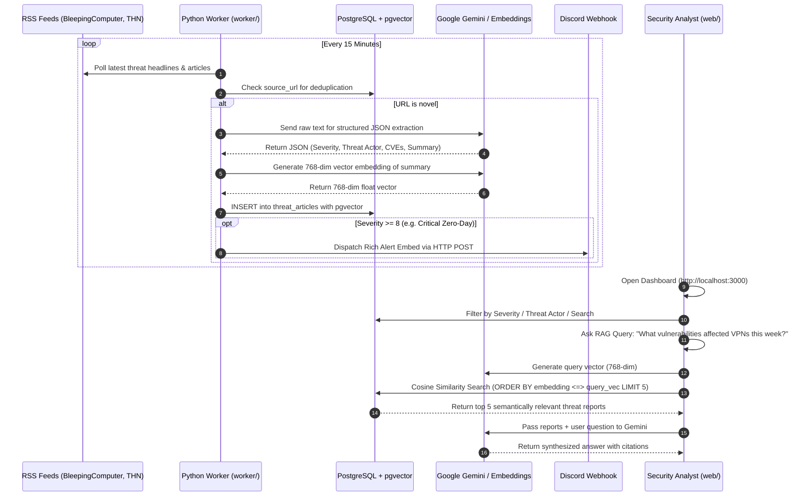

# Sentinel AI — Autonomous Threat Intelligence Platform

> **Decoupled cybersecurity intelligence pipeline**: Automated RSS ingestion, LLM-based structured extraction, 768-dimensional vector embeddings stored in PostgreSQL with `pgvector`, paired with a Next.js analytical command center and RAG chat assistant.

---

## 1. Executive Summary

Sentinel AI operates as an autonomous cybersecurity intelligence platform designed to ingest raw threat feeds, transform unstructured narratives into structured tactical indicators (CVEs, threat actors, CVSS-style severity scores 1–10), calculate semantic vector embeddings, and empower security analysts with an AI-driven Retrieval-Augmented Generation (RAG) assistant.

---

## 2. Global Directory Structure

```text
cs-news/
├── docker-compose.yml       # Orchestrates the DB (pgvector), Worker, and Web App
├── .env.example             # Template for API keys, Webhooks, DB Credentials
├── .env                     # Local environment file (ignored by Git)
├── .gitignore               # Strict exclusion rules for secrets, builds, and venvs
├── README.md                # System Architecture, API reference, & Setup Guide
├── db/
│   └── init.sql             # SQL script initializing tables, indexes, and pgvector
├── worker/                  # Python-based Intelligence Ingestion Daemon
│   ├── Dockerfile
│   ├── requirements.txt
│   ├── main.py              # Application entry point and 15-minute scheduler loop
│   ├── fetcher.py           # RSS parsing (BleepingComputer, The Hacker News, CISA)
│   ├── ai_pipeline.py       # LLM calls for JSON extraction and 768-dim embeddings
│   ├── db_client.py         # PostgreSQL connection pool & insertion logic
│   └── alerts.py            # Discord/Telegram webhook payload formatting
└── web/                     # Next.js Presentation & RAG Interface
    ├── Dockerfile
    ├── package.json
    ├── tsconfig.json
    ├── tailwind.config.ts
    ├── postcss.config.mjs
    ├── next.config.mjs
    ├── src/
    │   ├── app/
    │   │   ├── layout.tsx
    │   │   ├── globals.css
    │   │   ├── page.tsx     # Main Threat Feed Dashboard
    │   │   └── api/
    │   │       ├── chat/    # RAG API Route for Next.js AI chat (pgvector similarity)
    │   │       └── feed/    # REST API for paginated threats & aggregate metrics
    │   ├── components/      # UI components (ThreatCard, ChatBox, FilterBar, Navbar)
    │   ├── types/           # TypeScript interfaces for Threat Articles & Chat
    │   └── lib/
    │       └── db.ts        # Database connection pool (pg.Pool)
```

---

## 3. End-to-End Execution Flow



---

## 4. Database Layer (`db/`)

The database relies on **PostgreSQL 16** with the **`pgvector`** extension.

| Column | Data Type | Purpose |
| :--- | :--- | :--- |
| `id` | `UUID` | Unique identifier (Primary Key). |
| `source_url` | `TEXT` | Original article URL (UNIQUE constraint for deduplication). |
| `title` | `TEXT` | Raw headline fetched from the RSS feed. |
| `summary` | `TEXT` | Executive summary synthesized by the LLM pipeline. |
| `threat_actor` | `TEXT` | Extracted threat actor/APT name (e.g., LockBit 3.0, Volt Typhoon). |
| `severity` | `INTEGER` | AI-assigned threat score (1–10) determining alert routing. |
| `cve_list` | `JSONB` | Array of extracted CVE identifiers (e.g., `["CVE-2024-21887"]`). |
| `embedding` | `VECTOR(768)` | High-dimensional vector mapping semantic meaning. |
| `source` | `TEXT` | Name of the intelligence source (e.g., BleepingComputer). |
| `published_at` | `TIMESTAMPTZ` | Timestamp when the advisory was published. |

Vector queries utilize HNSW cosine similarity:
```sql
SELECT id, title, summary, threat_actor, severity, cve_list,
       1 - (embedding <=> $1::vector) AS similarity
FROM threat_articles
WHERE embedding IS NOT NULL
ORDER BY embedding <=> $1::vector ASC
LIMIT 5;
```

---

## 5. Quickstart & Local Deployment

### Prerequisites
* Docker and Docker Compose installed
* (Optional) [Google Gemini API Key](https://aistudio.google.com/) for live LLM extraction & vector embeddings. *Note: Sentinel AI includes an autonomous fallback engine that operates seamlessly without an API key.*

### Step 1: Clone and Configure Environment
```bash
git clone https://github.com/Rootexploiter5/cs-news.git
cd cs-news

# Copy the example environment template
cp .env.example .env
```

Edit `.env` to supply your credentials:
```ini
GEMINI_API_KEY=your_gemini_api_key_here
DISCORD_WEBHOOK_URL=https://discord.com/api/webhooks/your/token
```

### Step 2: Spin Up the Stack with Docker Compose
```bash
docker compose up --build -d
```

### Step 3: Verify Container Health
```bash
docker compose ps
```
You will see three containers running:
* `sentinel_db`: Healthy on `127.0.0.1:5432`
* `sentinel_worker`: Actively polling feeds and processing vectors
* `sentinel_web`: Next.js web application on port `3000`

### Step 4: Access the Command Center
Open your browser to:
**[http://localhost:3000](http://localhost:3000)**

---

## 6. Live Ingestion Logs & Troubleshooting

To monitor real-time RSS feed polling, extraction, and vector insertions:
```bash
# View worker logs
docker compose logs -f worker

# View web RAG queries
docker compose logs -f web

# View database operations
docker compose logs -f db
```

---

## 7. License
Distributed under the MIT License. Built for cybersecurity defenders and threat intelligence analysts.

